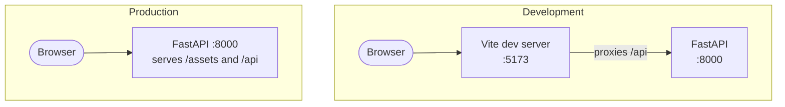

# spa-with-fastapi-and-react

A task board built as a single page app: a React frontend in TypeScript talking to a FastAPI backend, with one container image that serves both in production.

The interesting part is not the task list. It is that the same codebase runs two ways — two dev servers with hot reload while you work, and a single process serving static assets and JSON when you ship — without the frontend knowing which one it is in.

## The two modes



In development, Vite owns the page and forwards `/api` to FastAPI, so the frontend requests the same relative paths it will use in production. Nothing in `src/` refers to a host or a port. In production, FastAPI mounts the built assets and falls back to `index.html` for any path the router does not claim, which is what makes client-side routing work on a hard refresh.

## The API

| Method   | Path              | Description                  |
| -------- | ----------------- | ---------------------------- |
| `GET`    | `/api/tasks`      | Lists tasks, newest first     |
| `POST`   | `/api/tasks`      | Creates a task                |
| `PATCH`  | `/api/tasks/{id}` | Renames or completes a task   |
| `DELETE` | `/api/tasks/{id}` | Removes a task                |
| `GET`    | `/api/health`     | Liveness probe                |

Interactive documentation is at `/docs`.

## Layout

```
backend/src/taskboard/
├── domain/           Entities, the repository protocol, and the use cases
├── infrastructure/   SQLAlchemy implementation of that protocol
├── api/              Routes, schemas, and dependency wiring
└── static.py         Mounts the built frontend with an SPA fallback

frontend/src/
├── api.ts            The only module that knows about HTTP
├── components/       Presentational pieces
└── App.tsx           State and orchestration
```

Both sides keep transport at the edge. The backend's use cases never see a request object; the frontend's components never see `fetch`.

## Running it

**Development**, with hot reload on both sides:

```bash
docker compose up --build
```

The app is at <http://localhost:5173> and the API at <http://localhost:8000>. Set `WEB_PORT` and `API_PORT` if those are taken.

**Production**, the single image that actually ships:

```bash
docker compose --profile prod up --build app
```

Everything is served from <http://localhost:8000>, assets and API alike.

## Running the tests

```bash
docker compose --profile test run --rm tests
```

The suite drives the API through its full stack — create, list, complete, delete — against a temporary SQLite file, plus a check that timestamps survive the round trip with their timezone intact.

The frontend is type-checked as part of the production build: `npm run build` runs `tsc --noEmit` before Vite touches anything, so a type error fails the image build rather than reaching the browser.

## Deliberate simplifications

- **SQLite, not PostgreSQL.** One file, one container, no orchestration. The repository protocol means swapping it is one class, which is the point demonstrated at length in [`fastapi-aws-ecs-fargate`](https://github.com/jesusroncal94/fastapi-aws-ecs-fargate).
- **The schema is created at startup.** A second table would justify migrations.
- **CORS is configured for development only.** In production the SPA and the API share an origin, so the middleware has nothing to allow. `CORS_ORIGINS` is empty in the shipped image.
- **No authentication.** Adding it would double the size of the example without teaching anything about the packaging question this repository is about.
- **Timestamps are normalised to UTC on read**, because SQLite stores no timezone and would otherwise hand back naive datetimes that differ from what was written.

## License

MIT — see [LICENSE](LICENSE).
